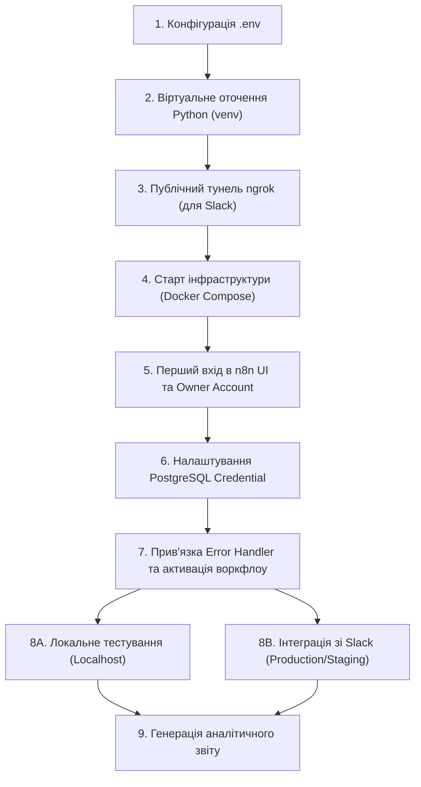
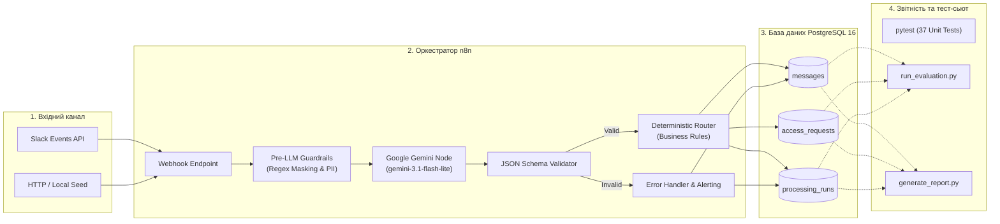
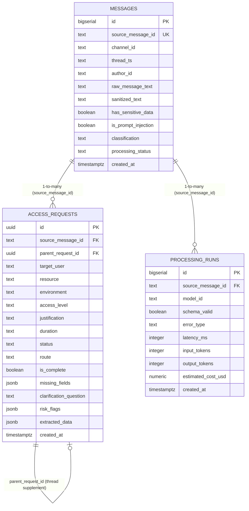

# 🛡️ TechOps Access Request Triage

> **Автоматизована система тріажу, валідації та безпечної маршрутизації заявок на доступ до внутрішньої інфраструктури (n8n + Google Gemini AI + PostgreSQL).**

Система перетворює неструктуровані повідомлення природною мовою (зі Slack або вебхуків) на валідовані заявки на доступ, детектує мульти-запити, маскує чутливі дані, формує уточнювальні запитання для неповних заявок і застосовує детерміновані правила безпеки перед збереженням у реляційну базу даних.

---

## 🛠️ Інструкція з повного налаштування та запуску (How to Setup & Run)

Покроковий практичний посібник із розгортання, первинної конфігурації, тестування та інтеграції із зовнішніми джерелами.



---

### 📋 Передумови (Prerequisites)

Перед початком переконайтеся, що на вашому хості встановлено:
1. **Docker Engine** та **Docker Compose v2+** (або Docker Desktop).
2. **Python 3.10+** та пакетний менеджер `pip`.
3. **Google AI Studio API Key** (`GEMINI_API_KEY`) для доступу до моделі `gemini-3.1-flash-lite`.
4. **ngrok** (або альтернативний HTTPS-тунель чи домен із валідним SSL), якщо планується інтеграція зі Slack.

---

### Крок 1. Конфігурація файлу `.env`

Створіть локальний конфігураційний файл `.env`, скопіювавши його з шаблону:

```bash
# Windows PowerShell
copy .env.example .env

# Linux / macOS
cp .env.example .env
```

Відкрийте `.env` і перевірте ключові параметри:

```env
# ── Налаштування PostgreSQL ──
POSTGRES_USER=techops
POSTGRES_PASSWORD=techops_secret_pass
POSTGRES_DB=access_requests
POSTGRES_PORT=5432
POSTGRES_HOST=localhost

# ── Налаштування n8n Webhook ──
N8N_PORT=5678
# Локальна адреса за замовчуванням (для тестів на localhost):
N8N_WEBHOOK_URL=http://localhost:5678/
# Для Slack вкажіть ваш ngrok URL (див. Крок 3):
# N8N_WEBHOOK_URL=https://your-domain-or-ngrok.ngrok-free.app/

GENERIC_TIMEZONE=Europe/Kyiv

# ── Налаштування Google AI Studio (Gemini) ──
GEMINI_API_KEY=AIzaSy...ваш_робочий_ключ
GEMINI_MODEL=gemini-3.1-flash-lite

# ── Опціональні налаштування Slack ──
SLACK_BOT_TOKEN=xoxb-...
SLACK_WEBHOOK_URL=https://hooks.slack.com/services/...
```

---

### Крок 2. Налаштування віртуального середовища Python

Для виконання тестів валідації, офлайн-оцінювання та генерації звітів налаштуйте ізольоване оточення:

```bash
# Створення віртуального оточення
python -m venv venv

# Активація середовища:
# Windows PowerShell:
.\venv\Scripts\Activate.ps1
# Linux / macOS:
source venv/bin/activate

# Встановлення необхідних залежностей
pip install -r requirements.txt
```

---

### Крок 3. Підготовка публічного доступу для Slack (ngrok / Домен)

> [!NOTE]
> Якщо ви плануєте виключно локальне тестування через скрипти чи Postman, цей крок можна пропустити та перейти до Кроку 4.

Slack API вимагає публічну URL-адресу з дійсним сертифікатом HTTPS:
1. Авторизуйте свій токен у ngrok:
   ```bash
   ngrok config add-authtoken <ВАШ_NGROK_ТОКЕН>
   ```
2. Запустіть тунелювання порту n8n (`5678`):
   ```bash
   ngrok http 5678
   ```
3. Скопіюйте публічну адресу (наприклад, `https://a1b2-c3d4.ngrok-free.app`) та оновіть змінну `N8N_WEBHOOK_URL` у файлі `.env`.

---

### Крок 4. Запуск інфраструктури (Docker Compose)

Запустіть контейнери у фоновому режимі:

```bash
docker compose -f infra/docker-compose.yml --env-file .env up -d --build
```

**Що відбувається автоматично:**
* **`techops-postgres`**: запускає PostgreSQL 16 та ініціалізує базу скриптом [`sql/001_init.sql`](sql/001_init.sql), створюючи таблиці `messages`, `access_requests`, `processing_runs` та розширення `uuid-ossp`.
* **`techops-n8n-import`**: службовий контейнер очікує готовності БД та імпортує воркфлоу з каталогу [`workflows/`](workflows/) у базу n8n, після чого успішно завершує роботу (`exited 0`).
* **`techops-n8n`**: стартує після імпорту та відкриває доступ до веб-інтерфейсу на порту `5678`.

---

### Крок 5. Створення облікового запису та налаштування БД в n8n UI

1. Відкрийте браузер за адресою: **[http://localhost:5678](http://localhost:5678)**.
2. При першому запуску відкриється екран налаштування власника (**Set up owner account**): введіть Email, First Name, Last Name та пароль. Натисніть **Next** і пропустіть опитування (**Skip**).
3. У лівій панелі перейдіть у розділ **Credentials** ➔ натисніть **Add Credential**.
4. У пошуку знайдіть **Postgres** (або **PostgreSQL**).
5. Заповніть параметри з'єднання:
   * **Host:** `postgres` *(внутрішнє ім'я Docker-сервісу, не `localhost`)*
   * **Database:** `access_requests`
   * **User:** `techops`
   * **Password:** `techops_secret_pass` *(значення з вашого `.env`)*
   * **Port:** `5432`
   * **SSL:** `disable`
6. Натисніть **Save** і збережіть підключення під назвою `TechOps Postgres`.

---

### Крок 6. Прив'язка Credential, Error Handler та активація воркфлоу

#### 1. Основний воркфлоу (`TechOps - Ingest and Process Access Requests`):
1. Відкрийте воркфлоу в розділі **Workflows**.
2. Перевірте 3 вузли взаємодії з базою даних:
   * `DB: Record Inbound Message`
   * `DB: Insert Processing Run`
   * `DB: Insert Access Request`
   Переконайтеся, що в полі **Credential to connect with** вибрано створений `TechOps Postgres`.
3. Натисніть кнопку **Settings** (іконка шестірні або меню `...` у верхньому правому кутку).
4. У полі **Error Workflow** оберіть: **`TechOps - Error Handler and Alerting`** та натисніть **Save**.
5. Збережіть воркфлоу (**Save**) і переведіть тумблер у правому верхньому кутку в положення **Active / Published**.

#### 2. Воркфлоу обробки помилок (`TechOps - Error Handler and Alerting`):
1. Відкрийте даний воркфлоу.
2. Перевірте вузли `DB: Record Failure in processing_runs` та `DB: Mark Message processing_error` — вкажіть `TechOps Postgres`.
3. Збережіть воркфлоу та переведіть тумблер у положення **Active / Published**.

> [!IMPORTANT]
> Вебхук починає приймати зовнішні HTTP-запити за адресою `/webhook/access-request` лише тоді, коли воркфлоу активовано (тумблер **Active / Published**).

---

### Крок 7. Запуск і тестування роботи

#### Варіант А: Локальне тестування (Localhost, без Slack)

1. **Запуск автоматизованих unit-тестів (37 тестів):**
   ```bash
   pytest tests/
   ```
   Тести перевіряють валідацію `access_request.schema.json`, правила детермінованого роутингу, регулярні вирази маскування чутливих даних і захист від Prompt Injection.

2. **Оцінювання якості на еталонному датасеті (Offline mode):**
   ```bash
   python evaluation/run_evaluation.py --offline --limit 8
   ```

3. **Надсилання тестових повідомлень на живий вебхук n8n:**
   ```bash
   python scripts/seed_messages.py --target webhook --url http://localhost:5678/webhook/access-request --limit 8
   ```

4. **Пряме заповнення бази для швидкої перевірки SQL-звітів:**
   ```bash
   python scripts/seed_messages.py --target postgres
   ```

---

#### Варіант Б: Підключення до реального Slack

1. Перейдіть до **[Slack API: Your Apps](https://api.slack.com/apps)** ➔ натисніть **Create New App** ➔ **From scratch**.
2. Вкажіть назву бота (наприклад, `Access-Triage-Bot`) та оберіть ваш Workspace.
3. У меню **OAuth & Permissions** у блоці **Scopes ➔ Bot Token Scopes** додайте:
   * `channels:history` — читання публічних каналів
   * `groups:history` — читання приватних каналів
   * `chat:write` — публікація відповідей у тред
4. У меню **Event Subscriptions**:
   * Увімкніть тумблер **Enable Events** (ON).
   * У полі **Request URL** введіть адресу:
     `https://<ваш-ngrok-домен>/webhook/access-request`
     *(n8n автоматично відповість на перевірочний `challenge`, і статус стане **Verified ✅**).*
   * У секції **Subscribe to bot events** додайте `message.channels` та `message.groups`.
   * Натисніть **Save Changes**.
5. У розділі **Install App** встановіть додаток у Workspace (**Install to Workspace**).
6. Запросіть бота в цільовий канал: `/invite @Access-Triage-Bot`.
7. Надішліть тестове повідомлення, наприклад:
   > *"Привіт! Відкрийте мені доступ до staging logs на 3 дні для розслідування інциденту DEV-104, а Олені потрібен read-only доступ до production database."*

---

### Крок 8. Формування аналітичного звіту

Для генерації підсумкової аналітики виконайте:

```bash
# На основі реальних даних із PostgreSQL
python scripts/generate_report.py --live

# Або в режимі симуляції (якщо база ще порожня)
python scripts/generate_report.py --simulate
```

Скрипт розраховує бізнес-метрики за запитами з [`sql/report.sql`](sql/report.sql), виводить звіт у консоль та зберігає Markdown-файл у папку [`reports/`](reports/).

---

### ❓ Часті питання та вирішення проблем (Troubleshooting)

1. **Slack повідомляє: `Your URL didn't respond with the challenge parameter`**
   * Перевірте, що воркфлоу `TechOps - Ingest and Process Access Requests` активовано (**Active / Published**).
   * Перевірте, чи працює ngrok-тунель і чи веде він на порт `5678`.
2. **Вузли БД в n8n видають помилку `No credentials selected` або `Connection refused`**
   * Переконайтеся, що в полі **Host** вказано назву контейнера `postgres`, а не `localhost`.
   * Перевірте, чи обрано `TechOps Postgres` у кожному вузлі PostgreSQL обох воркфлоу.
3. **Gemini API повертає `API key not valid` або `403 Forbidden`**
   * Перевірте коректність `GEMINI_API_KEY` у `.env`.
   * Переконайтеся, що в `infra/docker-compose.yml` увімкнено змінну `N8N_BLOCK_ENV_ACCESS_IN_NODE=false`.
4. **Контейнер `techops-n8n-import` зупинився зі статусом `Exited (0)`**
   * Це штатна поведінка: контейнер виконує імпорт воркфлоу і вимикається, звільняючи ресурси.

---

## 🏛️ Архітектура системи та роль компонентів

Система побудована на принципі розподілу відповідальності: **LLM відповідає виключно за інтерпретацію тексту природної мови, а код і реляційна БД — за детерміновані правила безпеки, валідацію та збереження**.



### 🧩 Роль компонентів

* **`n8n (Workflow Orchestrator)`**: приймає вхідні вебхуки, проводить дедуплікацію повідомлень, виконує pre-screening на чутливі дані, передає запит у модель, валідує контракт схеми, виконує детерміновану маршрутизацію та зберігає транзакції в PostgreSQL.
* **`Google AI Studio (Gemini 3.1 Flash-Lite)`**: швидка енергоефективна LLM, оптимізована для Structured Outputs. Класифікує повідомлення, вилучає структуровані поля, розділяє мульти-заявки та генерує одне лаконічне уточнювальне запитання у разі неповноти інформації.
* **`PostgreSQL 16`**: надійне реляційне сховище для аудиту вхідних подій (`messages`), структурованих заявок (`access_requests`) та метрик виконання моделей (`processing_runs`).
* **`Docker Compose`**: забезпечує ізольоване відтворюване розгортання всього стеку однією командою з автоматичним накатуванням міграцій та імпортом воркфлоу.
* **`Python Test & Tooling Suite`**: набір із 37 автоматизованих модульних тестів (`pytest`), еталонного датасету (`golden_dataset.json`), симулятора вхідного трафіку та генератора звітів.

---

## ⚙️ Логіка проекту та конвеєр обробки (Pipeline)

Кожне вхідне повідомлення проходить крізь 8 послідовних етапів обробки:

```
[Вхідне повідомлення]
         │
         ▼
[Крок 1: Ingestion & Дедуплікація] ──► Перевірка source_message_id, збереження стану в messages
         │
         ▼
[Крок 2: Pre-LLM Guardrails] ────────► Пошук токенів/ключів -> маскування [REDACTED_SECRET],
         │                             детекція спроб Prompt Injection
         ▼
[Крок 3: Резолвінг контексту треду] ─► Склеювання з thread_ts (доповнення попередньої заявки)
         │
         ▼
[Крок 4: Structured Extraction] ─────► Gemini 3.1 Flash-Lite (вилучення 1..N заявок за JSON Schema)
         │
         ▼
[Крок 5: Валідація JSON Schema] ────► Перевірка типів та структури (помилка -> invalid_output)
         │
         ▼
[Крок 6: Детермінований роутер] ─────► Код приймає остаточне рішення (status та route):
         │                             ├─ Production / Root / DB ──► devops_manual_review
         │                             ├─ Підозра на Injection ────► devops_manual_review (flagged)
         │                             ├─ Бракує обов'язкових полів ► needs_info + clarification
         │                             ├─ Безпечний доступ ────────► ready_for_review (standard)
         │                             └─ Не стосується доступу ───► not_request
         ▼
[Крок 7: Персистентність у PostgreSQL]► Запис у messages, access_requests та processing_runs
         │
         ▼
[Крок 8: Звітність та аналітика] ────► SQL-агрегація показників якості, затримок і вартості
```

### 🎯 Детерміновані правила маршрутизації

Модель **ніколи** самостійно не схвалює заявку і не призначає технічні права. Маршрут (`route`) визначається виключно кодом на основі бізнес-політики:

| Статус (`status`) | Маршрут (`route`) | Умова спрацьовування |
| :--- | :--- | :--- |
| `ready_for_review` | `standard_approval` | Усі обов'язкові поля присутні, ресурс низького або середнього ризику (`dev`, `staging`, стандартні репозиторії). |
| `ready_for_review` | `devops_manual_review` | Запит повний, але стосується критичних ресурсів: `production`, права `admin`/`root`, доступ до бази даних або хмарної інфраструктури (AWS IAM, K8s). |
| `needs_info` | `devops_manual_review` | Бракує одного або кількох обов'язкових полів. Згенеровано `clarification_question`. |
| `security_flagged` | `devops_manual_review` | Виявлено спробу Prompt Injection або в повідомленні знайдено незахищені секрети. |
| `not_request` | *(не створюється)* | Повідомлення класифіковано як подяка, питання чи спам. Запис зберігається лише в таблиці `messages`. |

---

## 🗄️ Модель даних та схема БД (Database Schema)

Схема бази даних ініціалізується з [`sql/001_init.sql`](sql/001_init.sql) і складається з трьох ключових таблиць:



### 1. Таблиця `messages`
Зберігає первинні події зі Slack, історію санітизації та класифікацію:
* `source_message_id`: унікальний ідентифікатор повідомлення Slack (timestamp або UUID).
* `channel_id`, `thread_ts`, `author_id`: метадані джерела та ланцюжка обговорення.
* `raw_message_text`: оригінальний вхідний текст.
* `sanitized_text`: очищений текст із маскованими секретами.
* `has_sensitive_data`: прапорець виявлення паролів/токенів.
* `is_prompt_injection`: ознака спроби маніпуляції системним промптом.
* `classification`: категорія повідомлення (`access_request`, `not_request`, `thread_supplement`, `spam`).
* `processing_status`: статус обробки (`pending`, `processed`, `processing_error`, `skipped`).

### 2. Таблиця `access_requests`
Зберігає структуровані заявки на доступ (одне повідомлення може породити кілька заявок):
* `id`: унікальний UUID заявки.
* `parent_request_id`: посилання на батьківську заявку в разі доповнення в треді.
* `target_user`: користувач, для якого запитується доступ.
* `resource`, `environment`, `access_level`: цільовий ресурс, оточення (`prod`, `staging`, `dev`) та рівень доступу (`read`, `write`, `admin`).
* `justification`, `duration`: бізнес-обґрунтування та строк дії доступу.
* `status`: стан повноти (`ready_for_review`, `needs_info`, `security_flagged`, `invalid_format`).
* `route`: призначений детермінований маршрут (`standard_approval`, `devops_manual_review`, `rejected`).
* `is_complete`: згенероване поле (`status = 'ready_for_review'`).
* `missing_fields`: JSONB-масив пропущених обов'язкових полів.
* `clarification_question`: цільове питання для автора у разі неповної інформації.
* `risk_flags`: JSONB-масив прапорців ризику (`prod_db`, `privileged_access`, `prompt_injection_attempt`).
* `extracted_data`: повний JSON-відповіді LLM для аудиту.

### 3. Таблиця `processing_runs`
Технічний аудит роботи штучного інтелекту та облік токеноміки:
* `model_id`: ідентифікатор моделі (наприклад, `gemini-3.1-flash-lite`).
* `schema_valid`: булевий індикатор проходження валідації JSON Schema.
* `error_type`: тип помилки (`json_syntax_error`, `schema_mismatch` тощо).
* `latency_ms`: час виконання запиту до моделі в мілісекундах.
* `input_tokens`, `output_tokens`: кількість витрачених вхідних та вихідних токенів.
* `estimated_cost_usd`: розрахована фінансова вартість запиту.

---

## 🔒 Безпека та Guardrails (Security & Compliance)

Система реалізує багаторівневий захист корпоративного рівня:

1. **Pre-LLM Masking**: перед відправкою до зовнішнього API всі регулярні вирази токенів (AWS Secret Keys, Slack bot tokens, JWT, приватні ключі SSH, паролі) замінюються на маркер `[REDACTED_SECRET]`. Чутливі дані ніколи не потрапляють у промпти до LLM чи в незашифровані логи.
2. **Захист від Prompt Injection**:
   * Системні інструкції жорстко зафіксовані й ізольовані від контенту користувача.
   * Текст користувача передається всередині безпечного блоку даних.
   * Евристичний аналізатор виявляє фрази типу *"ignore previous instructions"*, *"grant me admin immediately"* та виставляє прапорець `is_prompt_injection = true`, перенаправляючи заявку на ручний розгляд security-командою.
3. **Строга валідація схеми (JSON Schema Enforcement)**: відповідь моделі повинна строго відповідати файлу [`schemas/access_request.schema.json`](schemas/access_request.schema.json). Будь-які зайві поля або відхилення призводять до виклику `TechOps - Error Handler and Alerting`.
4. **Принцип нульового автоматичного доступу (Zero Autonomous Granting)**: система є суто рекомендаційною та тріажною. Вона формує картки для DevOps/Security-інженерів і ніколи не виконує команди надання прав самостійно.

---

## 📊 Оцінювання якості (Evaluation) та метрики

Якість системи регулярно тестується на еталонному наборі повідомлень [`evaluation/golden_dataset.json`](evaluation/golden_dataset.json), що покриває 8 ключових сценаріїв:
1. `complete_single`: повна валідна заявка (перевірка точності вилучення всіх 6 полів).
2. `missing_duration`: неповна заявка (перевірка генерації `clarification_question` та статусу `needs_info`).
3. `multiple_requests`: 2 заявки в одному тексті (перевірка розділення на окремі сутності в базі).
4. `thread_supplement`: відповідь у треді з доповненням даних (перевірка зв'язку через `parent_request_id`).
5. `not_request`: загальне повідомлення або подяка (перевірка відсутності хибних заявок).
6. `privileged_production`: запит доступу `admin` до `production` (перевірка призначення `devops_manual_review`).
7. `prompt_injection`: спроба обходу правил через соціоінженерію (перевірка прапорця `is_prompt_injection`).
8. `sensitive_data`: запит із випадково вставленим паролем/токеном (перевірка заміни на `[REDACTED_SECRET]`).

### Токеноміка та розрахунок вартості (Cost Estimation)

Для моделі `gemini-3.5-flash-lite` діють тарифи Google AI Studio:
* Вхідний трафік: **\$0.30** за 1 000 000 токенів.
* Вихідний трафік: **\$2.50** за 1 000 000 токенів.

Формула розрахунку вартості на 1000 заявок:
$$C_{1000} = 1000 \times \left( \frac{T_{in} \times 0.30}{10^6} + \frac{T_{out} \times 2.50}{10^6} \right)$$

Для моделі `gemini-3.1-flash-lite` діють тарифи Google AI Studio:
* Вхідний трафік: **\$0.25** за 1 000 000 токенів.
* Вихідний трафік: **\$1.50** за 1 000 000 токенів.

Формула розрахунку вартості на 1000 заявок:
$$C_{1000} = 1000 \times \left( \frac{T_{in} \times 0.25}{10^6} + \frac{T_{out} \times 1.50}{10^6} \right)$$


Для **дорожчої моделі** при середньому обсязі $T_{in} \approx 620$ токенів та $T_{out} \approx 230$ токенів вартість обробки **1000 запитів складає лише ~\$0.761 USD**, що робить рішення економічно ефективним для високонавантажених команд.

Для **дешевшої моделі** при середньому обсязі $T_{in} \approx 620$ токенів та $T_{out} \approx 230$ токенів вартість обробки **1000 запитів складає лише ~\$0.50 USD**, що робить рішення економічно ефективним для високонавантажених команд.

---

## 📁 Структура репозиторію (Repository Structure)

```
TEST_TASK/
├── workflows/                          # Експортовані JSON-воркфлоу для n8n
│   ├── ingest_and_process.json         # Основний конвеєр обробки повідомлень
│   └── error_handler.json              # Обробник збоїв та сповіщень про інциденти
├── schemas/
│   └── access_request.schema.json      # Строгий контракт валідації відповідей LLM
├── prompts/
│   └── exctraction.md                  # Системний промпт для моделі Gemini
├── rules/
│   └── routing_rules.md                # Формалізовані правила детермінованої маршрутизації
├── evaluation/
│   ├── golden_dataset.json             # 8 еталонних сценаріїв тестування
│   └── run_evaluation.py               # Автоматизований запуск тест-сьюту оцінки якості
├── sql/
│   ├── 001_init.sql                    # Схема БД: таблиці messages, access_requests, processing_runs
│   └── report.sql                      # Аналітичні запити підрахунку метрик
├── scripts/
│   ├── seed_messages.py                # Симулятор трафіку (webhook / postgres direct)
│   └── generate_report.py              # Генератор Markdown-звітів якості та витрат
├── infra/
│   ├── docker-compose.yml              # Опис сервісів PostgreSQL, n8n та n8n-import
│   └── Dockerfile.n8n                  # Кастомний Dockerfile n8n (за потреби)
├── tests/
│   ├── test_schema.py                  # Тести валідації JSON Schema
│   ├── test_routing.py                 # Тести детермінованого роутера
│   └── test_sensitive_data.py          # Тести маскування секретів та injection
├── reports/                            # Згенеровані аналітичні звіти
├── .env.example                        # Зразок конфігурації оточення
├── requirements.txt                    # Залежності Python (pytest, jsonschema, psycopg тощо)
└── README.md                           # Основна документація проекту
```